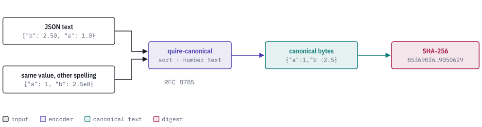
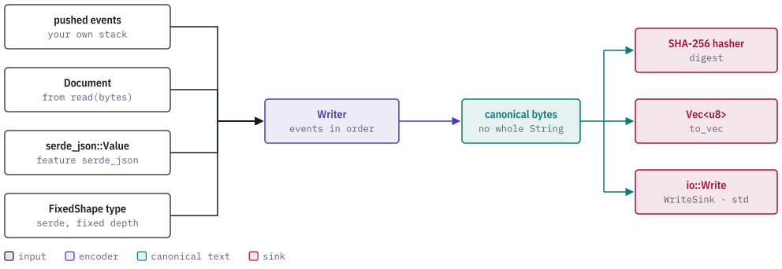

# quire-canonical

[](https://discord.gg/k8DVhuYBR2)

quire-canonical turns a JSON value into its one canonical byte string, as
defined by RFC 8785 (the JSON Canonicalization Scheme), and hashes those bytes
with SHA-256 while it writes them. `{"b": 2.50, "a": 1.0}` and
`{"a": 1, "b": 2.5e0}` are the same value spelled two ways; both come out as
`{"a":1,"b":2.5}` and both get the same digest. It also holds the one shared
reader for untrusted JSON, so the bytes you hash are the bytes you parsed.

It exists so that equal content gets equal identity. Anything that is named by
its content needs a digest that does not
change with key order, whitespace or number spelling, and that can be computed
on input of any depth without overflowing the stack or building the whole text
in memory first. Putting that in one small `no_std` crate means every other
repository mints identities the same way.

<picture>
  <source media="(prefers-color-scheme: dark)" srcset="docs/images/hero-dark.svg">
  
</picture>

> **Status: public prerelease.** The API is still changing and the crate is not
> published yet (`publish = false`). Expect breaking changes.

## How a value gets in

There are four ways to hand a value to the encoder, and all of them end in the
same `Writer`, which pushes canonical bytes, in order, to a `Sink`. A hasher,
a `Vec<u8>` and an `io::Write` adapter are sinks, so hashing needs no
intermediate string.

<picture>
  <source media="(prefers-color-scheme: dark)" srcset="docs/images/pipeline-dark.svg">
  
</picture>

Nothing recurses in proportion to its input and nothing bounds depth: only
byte limits apply, and a limit refuses the encoding rather than truncating it.
Arrays and scalars stream to the sink. While an object is open its bytes are
buffered so its members can be sorted, so a top-level object is held whole
before the first byte is hashed. See [docs/encoding.md](docs/encoding.md).

## Usage

Encode a typed value, from the crate documentation in `src/lib.rs` (run as a
doc-test):

```rust
use quire_canonical::{to_vec, FixedShape, Limits};

#[derive(serde::Serialize, FixedShape)]
struct Example { b: f64, a: &'static str }

let bytes = to_vec(&Example { b: 1e21, a: "ö" }, Limits::new(1024))?;
assert_eq!(bytes, "{\"a\":\"ö\",\"b\":1e+21}".as_bytes());
# Ok::<(), quire_canonical::Error>(())
```

Push events yourself, for data whose depth follows its input (from `src/writer.rs`,
also a doc-test):

```rust
use quire_canonical::{Limits, Writer};

let mut bytes = Vec::new();
let mut writer = Writer::new(&mut bytes, Limits::new(64));
writer.begin_object()?;
writer.name("b")?;
writer.begin_array()?;
writer.integer(1)?;
writer.null()?;
writer.end_array()?;
writer.name("a")?;
writer.string("ö")?;
writer.end_object()?;
assert_eq!(writer.finish()?, 23);
assert_eq!(bytes, "{\"a\":\"ö\",\"b\":[1,null]}".as_bytes());
# Ok::<(), quire_canonical::Error>(())
```

To hash instead of collect, call `sha256(&value, limits)`, or
`sha256_with_domain(label, &value, limits)` to bind a digest to a domain label.
To parse untrusted JSON, call `read(bytes, max_input_bytes)`, which returns a
`Document` that `to_vec` and `sha256` accept directly.

## Reference

| Item | What it does |
| --- | --- |
| `to_vec`, `sha256`, `sha256_with_domain`, `encode` | Encode any `Encode` value to bytes, to a digest, to a domain-labelled digest, or into a `Sink`. |
| `Writer` | Push-event encoder; refuses events out of order. |
| `read`, `Document`, `NodeRef` | The shared reader of untrusted JSON, into an arena tree. Refuses malformed input with the byte offset, and numbers with no finite double with their JSON pointer. |
| `FixedShape` and `#[derive(FixedShape)]` | Marks serde types whose depth is fixed by their schema; a recursive type fails to compile. |
| `Limits` | The canonical byte ceiling. There is no depth limit. |
| `AuthorityQualifiedSubjectReference` and its parts | A five-member identity key (authority, revision, digest, kind, object) with componentwise comparison. |

| Feature | Default | Effect |
| --- | --- | --- |
| `std` | on | Adds `WriteSink` and `Error::Sink`. Off, the crate is `no_std` + `alloc`. |
| `serde_json` | off | `Encode` for `serde_json::Value`, plus `drop_value` for deep values. |

Encoding rules: member names sort by UTF-16 code unit; numbers use ECMAScript
`Number::toString`; a Rust integer past 2^53 is refused, so an exact larger
integer must travel as a decimal string; strings are escaped per RFC 8785 with
no Unicode normalization. Golden vectors are in
[`tests/vectors/jcs-vectors.json`](tests/vectors/jcs-vectors.json).

## The Quire ecosystem

quire-canonical is a foundation crate: it depends on no other Quire repository
and is one of the shared libraries at the bottom of the figure. quire-spec-language (public) depends on it.

<picture>
  <source media="(prefers-color-scheme: dark)" srcset="docs/images/ecosystem-dark.svg">
  
</picture>

## Building and testing

```bash
make test       # default (+serde_json), preserve_order, no-std and arbitrary_precision lanes
make ci         # fmt-check, lint, test, no-std build, deny, audit-unsafe, docs
```

`make help` lists every target. The toolchain is pinned by `rust-toolchain.toml`
and includes the `thumbv7em-none-eabi` target.

Figures in `docs/images` are generated by `docs/images/figures.py` with the
docs-figures skill from agent-ix/dev-tools.

## Contributing

Contributions require a signed CLA; see [CONTRIBUTING.md](CONTRIBUTING.md) and
[CLA.md](CLA.md). Questions go to an issue or [Discord](https://discord.gg/k8DVhuYBR2).

## License

AGPL-3.0-or-later. See [LICENSE](LICENSE).
